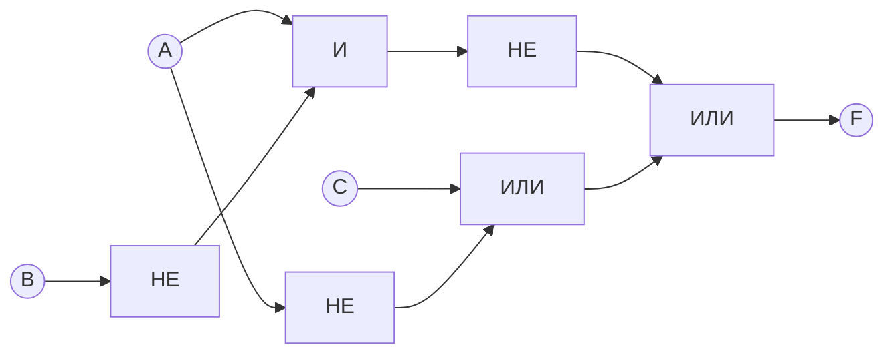
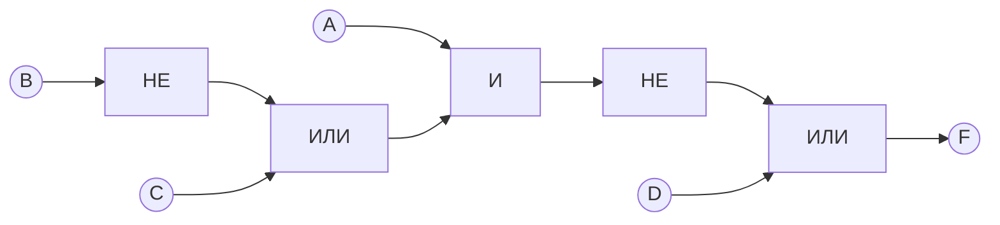

# Домашняя работа по логическим схемам

Обозначения: `¬` — НЕ, `∧` — И, `∨` — ИЛИ, `→` — импликация. На исходных схемах `&` означает И, блок `1` — ИЛИ, кружок на выходе — отрицание.

## Часть 1. Из схемы в формулу

### Схема 1

Верхний элемент И получает `¬A` и `B`, нижний — `A` и `¬B`. Их выходы объединяются элементом ИЛИ.

**Ответ:**

$$
F=(\neg A\land B)\lor(A\land\neg B).
$$

Это исключающее ИЛИ: результат равен 1, когда A и B различаются.

### Схема 2

Обозначим четыре входа сверху вниз как **A, B, C, D**.

| Элемент | Формула на выходе |
| --- | --- |
| Верхний ИЛИ | `¬A ∨ B` |
| Верхний И | `B ∧ ¬A` |
| ИЛИ, объединяющий эти две ветви | `(¬A ∨ B) ∨ (B ∧ ¬A)` |
| Средний ИЛИ | `¬B ∨ ¬C` |
| Нижний ИЛИ | `¬C ∨ D` |
| Нижний И | `(¬B ∨ ¬C) ∧ (¬C ∨ D)` |

Последний элемент ИЛИ объединяет верхнюю и нижнюю ветви.

**Ответ по структуре схемы:**

$$
F=\bigl[(\neg A\lor B)\lor(B\land\neg A)\bigr]
\lor\bigl[(\neg B\lor\neg C)\land(\neg C\lor D)\bigr].
$$

**Упрощение:**

$$
(\neg A\lor B)\lor(B\land\neg A)=\neg A\lor B,
$$

$$
(\neg B\lor\neg C)\land(\neg C\lor D)
=\neg C\lor(\neg B\land D).
$$

Поскольку `B ∨ (¬B ∧ D) = B ∨ D`, получаем:

$$
\boxed{F=\neg A\lor B\lor\neg C\lor D}.
$$

При значениях на рисунке `A = 0`, `B = 1`, `C = 0`, `D = 0` результат **F = 1**.

## Часть 2. Из формулы в схему

Используем замену импликации:

$$
X\to Y=\neg X\lor Y.
$$

В схемах ниже каждый блок НЕ имеет один вход, блоки И и ИЛИ — по два входа. Одинаковые буквы обозначают один и тот же входной сигнал.

### Формула 1

$$
F=(A\land\neg B)\to(C\lor\neg A).
$$

После замены импликации:

$$
F=\neg(A\land\neg B)\lor(C\lor\neg A).
$$

**Схема:**

Порядок вычисления:

1. Получить `¬B` и `¬A`.
2. Вычислить `A ∧ ¬B`, затем инвертировать результат.
3. Вычислить `C ∨ ¬A`.
4. Соединить результаты пунктов 2 и 3 элементом ИЛИ.

Проверка упрощением:

$$
F=(\neg A\lor B)\lor C\lor\neg A
=\boxed{\neg A\lor B\lor C}.
$$

### Формула 2

$$
F=\neg\bigl(A\land(B\to C)\bigr)\lor D.
$$

После замены импликации:

$$
F=\neg\bigl(A\land(\neg B\lor C)\bigr)\lor D.
$$

**Схема:**

Порядок вычисления:

1. Получить `¬B`.
2. Вычислить `¬B ∨ C`.
3. Соединить результат с A элементом И.
4. Инвертировать результат пункта 3.
5. Соединить его с D элементом ИЛИ.

Проверка по законам де Моргана:

$$
F=\neg A\lor\neg(\neg B\lor C)\lor D
=\boxed{\neg A\lor(B\land\neg C)\lor D}.
$$
